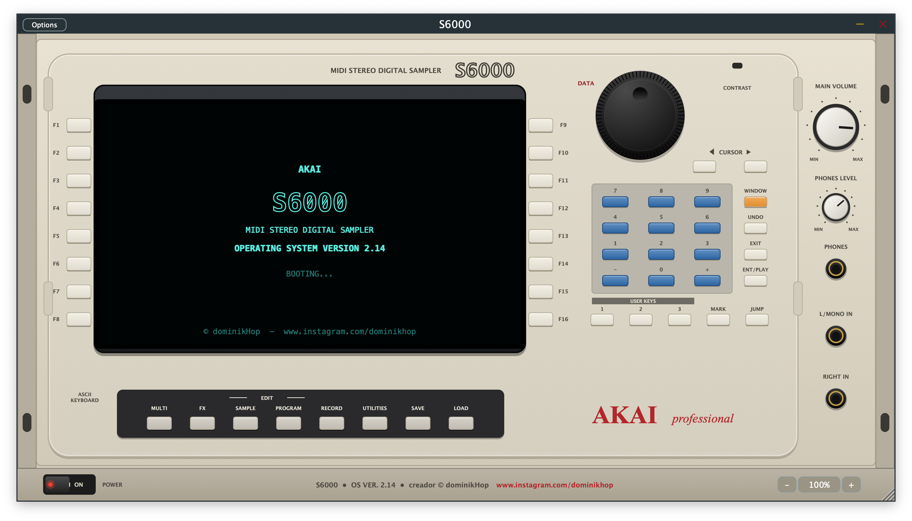

# S6000 — emulación del sampler AKAI S6000 (OS Ver. 2.14)

**Creador: © dominikHop — [www.instagram.com/dominikhop](https://www.instagram.com/dominikhop)**



Plugin **AU / VST3 / AAX / Standalone** hecho con **JUCE 8** (Projucer o CMake).
El panel reproduce el S6000: chasis color crema, display tipo **OLED** (texto de 10–12 pt),
16 teclas **F1–F16**, rueda **DATA**, teclado numérico, **WINDOW / UNDO / EXIT / ENT‑PLAY**,
**USER KEYS 1‑3**, **MARK / JUMP**, las 8 teclas de modo con LED bajo la pantalla,
**MAIN VOLUME**, **PHONES LEVEL** y el botón **POWER** abajo a la izquierda.

---

## 1. Compilar

### Projucer
1. Copia la carpeta junto a JUCE 8 (`../JUCE`), o ajusta la ruta global de módulos en Projucer.
2. Abre `S6000.jucer` → *Save and Open in IDE* (Xcode, Visual Studio 2022 o Linux Makefile).
3. **AAX**: pon el AAX SDK en `SDKs/AAX` (o cambia `aaxFolder` en el exportador). Sin el SDK, quita AAX de *Plugin Formats*.

Módulos asignados: `juce_audio_basics, juce_audio_devices, juce_audio_formats, juce_audio_plugin_client,
juce_audio_processors, juce_audio_utils, juce_core, juce_data_structures, juce_events,
juce_graphics, juce_gui_basics, juce_gui_extra`.

### CMake
```
cmake -B build -DJUCE_DIR=/ruta/a/JUCE [-DAAX_SDK=/ruta/aax-sdk]
cmake --build build --config Release
```

### Pruebas sin JUCE (capa de disco y DSP)
```
python3 Tests/make_images.py /tmp/s6kimg
g++ -std=c++17 Tests/disk_test.cpp Source/Disk/*.cpp Source/Formats/*.cpp -lz -o disktest && ./disktest /tmp/s6kimg
```
Genera imágenes ISO, BIN 2352, DMG (zlib), FAT16 (con nombres largos y MBR), disco duro Akai
S1000/S3000 de 2 particiones con bloques fragmentados y disquete S1000, y comprueba que se lean.

---

## 2. Formatos que lee LOAD

| Origen | Qué se lee |
|---|---|
| Carpetas de tu ordenador (**S6000 HD** y **COMPUTER**) | `.AKM` multis, `.AKP` programas, `.WAV` / `.AIF` / `.AIFF` (lee el *smpl*: nota raíz y loop), `.MP3`, `.FLAC`, `.OGG` |
| `.iso`, `.cdr`, `.toast` | CD‑ROM ISO9660 / Joliet |
| `.bin` / `.img` de 2352 bytes | CD en bruto (MODE1 / MODE2) |
| `.img`, `.ima`, `.hds`, `.dsk`, `.raw` | FAT12/16/32 (discos del S5000/S6000, con MBR y particiones), **Akai S1000/S3000** (disco duro y CD‑ROM: particiones A, B, C…, volúmenes, FAT) y **disquetes S1000** (800K/1.6MB) |
| `.dmg` | Apple UDIF: sin comprimir, ADC y zlib (UDZO). Dentro: ISO, FAT o Akai |
| Si no se reconoce | **DEEP SCAN**: busca cabeceras de samples S1000 en todo el disco |

Los programas **S1000/S3000** se convierten a programas del S6000 (keygroups, zonas de velocidad,
afinación, envolvente) y cargan sus samples del mismo volumen.

No soportado: volúmenes HFS de Mac (conviértelos a ISO) y DMG con bzip2/LZFSE
(`hdiutil convert entrada.dmg -format UDZO -o salida.dmg`).

**SAVE** guarda en formato S5000/S6000: `.AKM`, `.AKP` y `.WAV` de 16 bits con loop y nota raíz.

---

## 3. Modos y páginas (según el manual)

* **LOAD**: lista de carpetas, OPEN/CLOSE FOLDER, LOAD FOLDER/MULTI/PROGRAM/SAMPLE (con casillas),
  AUDITION SAMPLE, GET INFO, DISK LIST (seleccionar, UPDATE, MOUNT IMAGE, UNMOUNT, carpeta del S6000 HD),
  DISK TOOLS (DISK INFO, CLEAR MEMORY, VIEW NAME/SIZE/DATE). Se puede arrastrar y soltar archivos sobre el plugin.
* **MULTI**: 128 partes, 1A–16B, PART LEVEL, OUTPUT, EFFECTS SEND, FINE TUNE, MIDI CHANNEL
  (cada una con su **WINDOW**), EDIT PART, PART TOOLS, MULTI TOOLS, MULTI LIST, PROGRAM LIST.
* **EDIT PROGRAM / EDIT PART**: OUTPUT, MIDI/TUNE (plantillas de afinación), EDIT USER, PITCHBEND,
  LFO 1, LFO 2, KEYGROUP, **ZONES** (4 capas por velocidad), KEYSPAN, KG PITCH/AMP, **FILTER (26 tipos)**,
  AMP ENVELOPE, FILTER ENVELOPE, AUX ENVELOPE, modulación **APM** (toca dos veces: cantidad ↔ fuente),
  GOTO SOURCE / GOTO DEST, PROG TOOLS, CREATE PROG.
* **EDIT SAMPLE** (manual p.141‑177): MASTER, TRIM, CHOP (EXTRACT / ERASE / CUT, slices → programa),
  LOOP (vista End→|←Start, AUTO FIND, CROSSFADE, LOOP LOCK), JOIN, MIX, MAKE STEREO, FADE UP/DOWN
  (LINEAR / LOG / SINE), TIME STRETCH y PITCH SHIFT (54 presets), BPM MATCH, RE‑SAMPLE (calidad y bits),
  EQ de 3 bandas con curva, COPY SAMPLE, SAMPLE TOOLS (W/FORM LOG/LIN), SAMPLE LIST.
  Forma de onda con vista general + zoom, resaltado entre START y END, línea de PLAY blanca animada
  e indicador PLAY/STOP; los puntos se arrastran con el ratón (rueda = zoom, doble clic = todo).
  Cada proceso termina con PLAY / KEEP ORIGINAL / NEW / BOTH / OVERWRITE + RENAME. **UNDO** deshace.
* **RECORD**: nivel, disparo (ONE KEY / THRESHOLD / MIDI NOTE), fuente (entrada o MAIN OUTS),
  longitud, nota original, mono/estéreo, ARM, medidores, KEEP / DISCARD / PLAY.
* **FX** (EB20): MULTIFX 1 y 2 (RING MOD/DIST → EQ → MOD → DELAY → REVERB → OUTPUT MIX),
  RV3 y RV4, plantillas (EFFECTS TOOLS), COPY FX, BYPASS.
* **SAVE**: VIEW MEMORY / VIEW DISK, SAVE MULTI/PROGRAM/SAMPLE, SAVE ALL, NEW FOLDER.
* **UTILITIES**: SYSTEM SETUP (afinación, nivel, tamaño de memoria, polifonía, interpolación),
  SET CLOCK, PREFERENCES, MIDI SETUP, MIDI FILTER, FX IN/OUTS, DISK UTILS, MEMORY TEST,
  SHOW HARDWARE, SET PLAY KEY, TEST TONE, SAVE O/S. **AUTOLOAD**: una carpeta llamada
  `AUTOLOAD` en la raíz del S6000 HD (`Documentos/S6000`) se carga al abrir.

---

## 4. Manejo

* **Touch and Tweak**: pulsa la tecla F junto al parámetro y gira **DATA** (arrastre circular,
  arrastre vertical en el centro o rueda del ratón). También puedes hacer clic en la caja del display.
* Teclado del ordenador: **F1–F12** (Shift+F1–F4 = F13–F16), ↑/↓ = DATA, ←/→ = CURSOR,
  Enter = ENT/PLAY, Esc = EXIT, Tab = WINDOW, números = teclado numérico, Ctrl/Cmd+Z = UNDO.
  Al nombrar (RENAME) escribe directamente con el teclado (ASCII KEYBOARD).
* **USER KEYS**: clic = ir a la página guardada; Shift+clic o clic derecho = guardar la página actual.
* **ZOOM** 50 %–200 % (botones −/+ abajo a la derecha, menú del porcentaje, Ctrl/Cmd + / − / 0 o
  arrastrando la esquina). **El último zoom se recuerda** al volver a abrir (ajuste global).
* **POWER**: apaga el sampler (silencio, pantalla negra) y al encender muestra el arranque del OS 2.14.

---

## 5. Bajo consumo de CPU

* Modulación (envolventes, LFO, APM) a *control rate* (cada 32 muestras) con rampas de ganancia.
* Las voces inactivas no cuestan nada; el filtro LP/HP se omite cuando está totalmente abierto.
* Cada canal del EB20 solo procesa mientras recibe señal o su cola suena.
* Interpolación **LINEAR** opcional (UTILITIES › SYSTEM SETUP) para gastar aún menos CPU.
* El dibujado del chasis se cachea; el display solo se redibuja cuando cambia algo.
* Sin asignaciones de memoria en el hilo de audio; los objetos borrados se liberan en el hilo de mensajes.

## 6. Salidas y proyecto

* 16 salidas como 8 pares estéreo (Main L‑R + 3/4 … 15/16) o mono 1–16. **MAIN VOLUME** solo afecta a 1/2, como en el hardware.
* La memoria (samples en FLAC, programas, multis y efectos) se guarda dentro del proyecto del DAW
  (se puede desactivar en PREFERENCES › Save In Project).

---

## 7. Notas honestas

* El código se revisó con g++ y clang contra las declaraciones de la API de JUCE 8, y la capa de
  discos y el DSP tienen pruebas ejecutables, pero **no se compiló contra JUCE real** en este entorno:
  la primera compilación puede pedir algún ajuste menor de API.
* El formato interno de disco de Akai S1000/S3000 se lee según la estructura documentada públicamente
  (akaiutil/akaitools); cada archivo se valida por su cabecera y, si la FAT no cuadra, se leen bloques
  contiguos (como están grabados los CD‑ROM de librerías).
* Los "virtual samples" (direct‑to‑disk) se cargan en RAM.

AKAI y S6000 son marcas de sus respectivos propietarios. Este proyecto es una emulación independiente.
