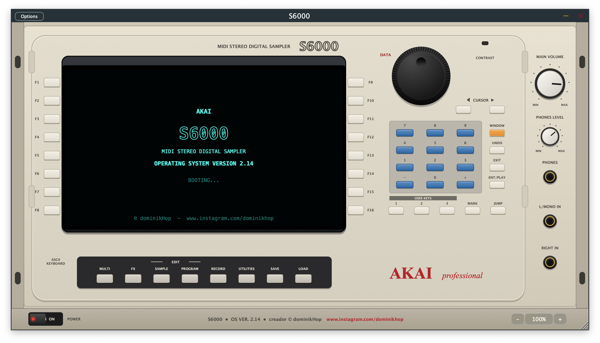

# S6000 — AKAI S6000 Sampler Emulation (OS Ver. 2.14)

**Created by © dominkHop** — [github.com/jomd7777/S6000](https://github.com/jomd7777/S6000)

A software recreation of the legendary **AKAI S6000 stereo digital sampler**, built with **JUCE 8** as an
**AU / VST3 / AAX / Standalone** plug-in. The front panel, the pages and the workflow follow the original
S5000/S6000 Operator's Manual, so if you know the hardware you already know this plug-in.

> *Leer en español: [README.es.md](README.es.md)*



---

## Highlights

- **Faithful front panel**: cream chassis, large **OLED-style display**, soft keys **F1–F16**, **DATA wheel**,
  numeric keypad, **WINDOW / UNDO / EXIT / ENT-PLAY**, **USER KEYS**, **MARK / JUMP**, the 8 mode keys with LEDs,
  **MAIN VOLUME**, **PHONES LEVEL** and a **POWER** switch with the OS 2.14 boot screen.
- **"Touch and Tweak"**: press the key next to a parameter, turn the DATA wheel. Just like the hardware.
- **Zoom 50 %–200 %** — the last zoom is remembered the next time you open it.
- **Loads classic Akai libraries**: S1000 / S3000 hard disks, CD-ROMs and floppies, plus S5000/S6000 files.
- **128 voices**, 128-part multis, 26 resonant filter types, 3 envelopes, 2 LFOs, modulation matrix (APM).
- **EB20 effects**: 2 multi-FX channels + 2 reverbs.
- **CPU friendly**: control-rate modulation, idle voices cost nothing, effects sleep when silent.

---

## Modes (as in the manual)

| Mode | What you can do |
|---|---|
| **LOAD** | Browse folders and disk images, load multis / programs / samples / whole folders, audition samples, DISK LIST, mount images, drag & drop files |
| **MULTI** | 128 parts (MIDI 1A–16B), level, pan, output, FX send, tuning, key range, mute / solo, EDIT PART |
| **EDIT PROGRAM** | Output, MIDI/Tune (tuning templates), Pitchbend, LFO 1 & 2, Keygroups, **4 velocity zones**, Keyspan, Filter (26 types), Amp / Filter / Aux envelopes, APM modulation |
| **EDIT SAMPLE** | Master, Trim, Chop (extract / erase / cut, slices → drum program), Loop (End→\|←Start splice view, auto-find, crossfade, loop lock), Join, Mix, Make Stereo, Fade up/down (LINEAR / LOG / SINE), Time-stretch & Pitch-shift (54 presets), BPM match, Re-sample (quality + bit depth), 3-band EQ with response curve. Waveform with overview + zoom, LOG/LIN, START..END highlight, animated play line and PLAY/STOP status; drag the edit points with the mouse. Every process ends with the original *PLAY / KEEP ORIGINAL / NEW / BOTH / OVERWRITE* prompt, plus **UNDO** |
| **RECORD** | Threshold / MIDI / one-key trigger, mono or stereo, record from the input or re-sample the main outs |
| **FX** | EB20: Distortion/Ring-mod → EQ → Chorus/Flange/Phaser/Rotary/Pitch → Delay → Reverb, plus RV3/RV4 |
| **SAVE** | Save multis, programs and samples as **.AKM / .AKP / .WAV** (S5000/S6000 format) |
| **UTILITIES** | System setup, preferences, MIDI setup & filter, FX in/outs, disk utils, memory test, test tone, AUTOLOAD |

---

## Supported disks and files

| Source | Read |
|---|---|
| Computer folders | `.AKM`, `.AKP`, `.WAV`, `.AIF` / `.AIFF` (root note + loop from the `smpl` chunk), `.MP3`, `.FLAC`, `.OGG` |
| `.iso`, `.cdr`, `.toast` | ISO9660 / Joliet CD-ROMs |
| `.bin` / `.img` (2352-byte sectors) | Raw CD images |
| `.img`, `.ima`, `.hds`, `.dsk`, `.raw` | FAT12/16/32 (S5000/S6000 disks), **Akai S1000/S3000** hard disks & CD-ROMs (partitions A, B, C…, volumes) and S1000 floppies |
| `.dmg` | Apple UDIF (raw, ADC, zlib) |

S1000/S3000 programs are converted with their full programming: keygroups, velocity zones, tuning,
velocity → level/attack/release/filter, LFO vibrato, filter and envelopes. Samples are found in the same volume
or anywhere on the disk.

Not supported: Mac HFS volumes and bzip2/LZFSE-compressed `.dmg` files.

---

## Installation (macOS)

Download the latest build from the **[Releases](../../releases)** page and copy:

| Format | Copy to |
|---|---|
| **AU** — `S6000.component` | `~/Library/Audio/Plug-Ins/Components/` |
| **VST3** — `S6000.vst3` | `~/Library/Audio/Plug-Ins/VST3/` |
| **AAX** — `S6000.aaxplugin` | `/Library/Application Support/Avid/Audio/Plug-Ins/` |
| **Standalone** — `S6000.app` | `/Applications/` |

The builds are not notarized. If macOS blocks them, run once in Terminal:

```
xattr -dr com.apple.quarantine ~/Library/Audio/Plug-Ins/Components/S6000.component
xattr -dr com.apple.quarantine ~/Library/Audio/Plug-Ins/VST3/S6000.vst3
xattr -dr com.apple.quarantine /Applications/S6000.app
```

Then rescan plug-ins in your DAW. In Logic, the AU appears under **AU Instruments › dominkHop › S6000**.

> **AAX note:** Pro Tools only loads AAX plug-ins signed with PACE/iLok. Unsigned builds work in *Pro Tools Developer* only.

---

## Quick start

1. Press **LOAD**, then **DISK TOOLS › MOUNT / LOAD FILE** to mount an `.iso` / `.img` or load `.wav` / `.aif` / `.mp3` files (or simply drag them onto the plug-in).
2. Open a partition and a volume, select a program and press **LOAD PROGRAM** (keep *WITH SAMPLES* checked).
3. Press **MULTI** — the program is assigned to Part 1. Play!
4. Put a folder named `AUTOLOAD` in `Documents/S6000` to load it automatically on start-up.

**Computer keyboard:** F1–F12 (Shift+F1–F4 = F13–F16), ↑/↓ = DATA, ←/→ = CURSOR, Enter = ENT/PLAY,
Esc = EXIT, Tab = WINDOW, digits = keypad, Cmd+Z = UNDO, Cmd + / − / 0 = zoom. Type directly when naming.

---

## Building from source

Requirements: **JUCE 8**, Xcode (macOS) or Visual Studio 2022 (Windows), C++17.
For AAX you also need the AAX SDK.

**Projucer**
1. Put JUCE next to this folder (`../JUCE`) or set the global module path in Projucer.
2. Open `S6000.jucer` → *Save and Open in IDE* → build.

**CMake**
```
cmake -B build -DJUCE_DIR=/path/to/JUCE [-DAAX_SDK=/path/to/aax-sdk]
cmake --build build --config Release
```

**Disk layer tests (no JUCE needed)**
```
python3 Tests/make_images.py /tmp/s6kimg
g++ -std=c++17 Tests/disk_test.cpp Source/Disk/*.cpp Source/Formats/*.cpp -lz -o disktest && ./disktest /tmp/s6kimg
```

### Project layout

```
Source/
  PluginProcessor.*   audio engine host, state, outputs, record input
  PluginEditor.*      front panel, zoom, keyboard shortcuts, drag & drop
  Core/               sampler engine, 26 filters, EB20 effects, sample editing, recorder, disk manager
  Disk/               ISO9660, FAT, Akai S1000/S3000, DMG, raw CD readers (pure C++)
  Formats/            S1000/S3000 samples & programs, AKP / AKM read & write
  UI/                 theme, panel controls, page system, pop-ups
  UI/Pages/           LOAD, MULTI, EDIT PROGRAM, EDIT SAMPLE, RECORD, FX, SAVE, UTILITIES
Tests/                disk image generator + tests, DSP tests
```

---

## How it was made

The project was designed and directed by **dominkHop** and written together with **Claude (Anthropic)**
as an AI coding assistant:

1. The original **S5000/S6000 Operator's Manual** was analysed page by page to map every mode, page,
   soft key and parameter.
2. The **disk layer** (ISO, FAT, Akai S1000/S3000, DMG) was written in plain C++ and tested with generated disk images.
3. The **sampler engine**, filters, envelopes, LFOs and EB20 effects were built for low CPU use and tested numerically.
4. The **front panel** was drawn in code from photos of the real S6000 — no bitmaps.
5. It was then compiled in Xcode and refined through real testing with classic Akai CD-ROM libraries
   (crash fixes, correct S1000 program conversion, larger display, centred pop-ups).

---

## Specifications

- 128-voice polyphony, 128 parts, 32 MIDI channels (1A–16B)
- 99 keygroups per program, 4 velocity zones per keygroup
- 26 resonant filters (2/4-pole LP, BP, HP, notch, peak, phaser, vowel…)
- Amp, filter and 4-stage aux envelopes; 2 LFOs with 9 waveforms
- 16 outputs (8 stereo pairs); MAIN VOLUME affects outputs 1/2 only, as on the hardware
- Session (samples as FLAC, programs, multis, FX) saved inside your DAW project

---

## Disclaimer

AKAI and S6000 are trademarks of their respective owners. This is an independent, non-commercial
emulation and is not affiliated with or endorsed by AKAI Professional. Use only sound libraries you own.

**© dominkHop**
